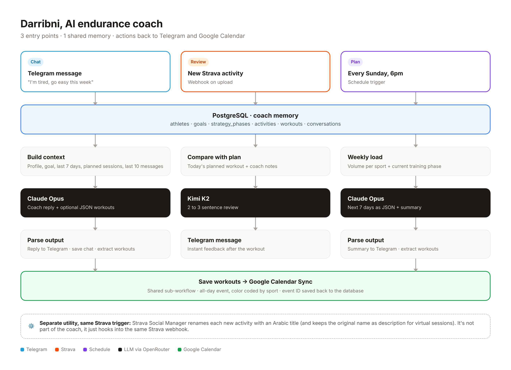

# Darribni: My AI Endurance Coach on Telegram

**Built with:** n8n, PostgreSQL, OpenRouter (Claude Opus, Kimi K2, free models), Telegram, Strava API, Google Calendar
**Status:** Live, in daily use since June 2026
**Role:** Solo, end to end (idea, data model, prompts, workflows, testing)

---

## TL;DR

Darribni ("train me" in Arabic) is a personal AI coach I built for my own MTB and road marathon training. I talk to it on Telegram like a real coach. It knows my goal, my training phase, my last 7 days on Strava and our past conversations. It plans my week every Sunday, puts each session in my Google Calendar, and reviews every workout the moment I upload it.

No app to open, no dashboard to check. The coach comes to me.

---

## The problem

Training apps give you either a rigid plan that ignores real life, or raw data with no guidance. A human coach is expensive and slow to reply.

What I wanted:
- A coach I can just text: "I'm tired today", "move Thursday's run", "I have a race in 6 weeks"
- A plan that adapts to what I actually did, not what I was supposed to do
- Feedback right after each session
- Sessions in my calendar, so training fits around client work

---

## What it does

### 1. Chat with the coach (Telegram)
I send a message on Telegram. Darribni pulls my full context (profile, active goal, last 7 days of activities, planned workouts, last 10 messages), then replies in under 150 words. If the conversation calls for it, it rewrites the next 7 days of workouts and they show up in my calendar automatically.

Example: "My knee feels off, can we go easy this week?" leads to a short reply and a lighter week, already scheduled.

### 2. Instant workout review (Strava)
The moment a new activity lands on Strava, Darribni saves it, compares it with what was planned for that day, and sends me a 2 to 3 sentence review on Telegram. Did I follow the plan? Did I go too hard?

### 3. Load my own plan from a calendar file
When I change my training plan, I export the calendar from Google Calendar (Settings > Export) and send the `.zip` or `.ics` straight to the bot with a caption like "here is my new training plan". Darribni unzips it, reads every upcoming session, replaces my future workouts, clears the old ones from the Darribni calendar and confirms how many sessions it loaded. Emojis in the event titles tell it the sport (🏃 run, 🚴 ride, 🏋️/💪 strength, 🏁 race). `/import` does the same by reading the calendar directly.

### 4. Weekly recap (every Sunday at 6pm)
Every Sunday evening it sums up my past week's volume per sport and walks me through the coming week's sessions from my plan, with one focus tip. It never rewrites the plan.

### 5. Google Calendar sync
Every planned workout becomes an all-day event in a dedicated "Darribni" calendar, color coded by sport (runs and rides stand out at a glance), with the description and target duration.

---

## Architecture

Five coach workflows, one shared memory:

| Workflow | Trigger | Job |
|---|---|---|
| [Darribni - Telegram](workflows/01-darribni-telegram-coach.json) | Telegram message | Routes plan files, `/import` and chat; conversational coach |
| [Darribni - Strava](workflows/02-darribni-strava-review.json) | New Strava activity | Save activity, review vs plan, notify |
| [Darribni - Weekly Planner](workflows/03-darribni-weekly-planner.json) | Every Sunday 6pm | Weekly recap of last week + next 7 days |
| [Darribni - Google Calendar Sync](workflows/04-darribni-google-calendar-sync.json) | Called by other workflows | Create calendar event, store event ID |
| [Darribni - Import Plan](workflows/06-darribni-import-plan.json) | Called by Telegram | Replace future workouts with sessions from a calendar file or Google Calendar |

### Side utility (not part of the coach): [Strava Social Manager](workflows/05-strava-social-manager-subworkflow.json)
A separate workflow that automatically renames each new Strava activity with a clean Arabic title based on its type (home session, ride, trail run, run, walk), and keeps the original name as the description for virtual sessions (Zwift, MyWhoosh). It runs on a free model since it's pure rule following.

It lives next to the coach only because both react to the same event: a new Strava activity. Strava allows a single webhook subscription per app, so the Strava workflow receives the event once and hands it to both the coach review and this title manager.

---

## Data model

| Table | What it holds |
|---|---|
| athletes | Profile, metrics, coach notes, Telegram and Strava IDs |
| goals | Target race or objective, status (Active) |
| strategy_phases | Training phases per goal with end dates (base, build, taper...) |
| activities | Every Strava activity with distance, moving time, avg heart rate |
| workouts | Planned sessions: date, sport, title, description, duration, calendar event ID |
| conversations | Chat history, user and coach messages |

Full schema: [schema.sql](schema.sql)

The database is the coach's long-term memory. Every workflow reads from it before calling the AI, so the model never works blind.

---

## AI design choices

**1. Context in, not memory in the model.**
Each call gets a fresh system prompt built from the database: profile, coach notes, active goal, last 7 days of activities and planned workouts, last 10 messages. The model is stateless, the system isn't.

**2. Structured output inside natural replies.**
The coach writes a short human reply and, when needed, adds a JSON block (`new_workouts` or `update_coach_notes`). A code node extracts the JSON, strips it from the message, and the athlete only sees the clean reply. A fallback parser catches JSON even when the model forgets the code fences.

**3. Right model for the job.**
- Claude Opus for coaching conversations and weekly planning (reasoning about load and recovery)
- Kimi K2 for the quick post-workout review (fast, cheap, good enough for 3 sentences)

**4. Hard guardrails in the prompt.**
Under 150 words. Only plan the next 7 days, never weeks ahead. Exact JSON keys. Messages capped at Telegram's 4,000 character limit.

**5. One shared sub-workflow for side effects.**
Both the chat and the weekly planner save workouts the same way and call the same Calendar Sync sub-workflow, which writes the event ID back to the database. One source of truth, no duplicate logic.

---

## What I learned

- **Agents are mostly context engineering.** The prompt is short. The work is in deciding what data to fetch, how much history to keep, and how to format it.
- **Make the model output data, not just text.** Once the coach could return workouts as JSON, it stopped being a chatbot and started taking actions.
- **Meet users where they already are.** Telegram and Google Calendar beat building a new app. Zero friction is the feature.
- **Plan for messy outputs.** LLMs don't always follow formats, so parsing needs fallbacks and defaults.

---

## What's next

- Persist coach notes updates automatically (the coach already outputs them, write-back is next)
- Push structured workouts to my Garmin watch
- Voice messages on Telegram (talk to the coach right after a ride)
- Weekly progress chart sent as an image
- Multi-athlete onboarding so friends can use it

---

## Run it yourself

1. **Database:** create a PostgreSQL database and run [schema.sql](schema.sql). Add yourself as a row in `athletes` (with your Telegram and Strava IDs), an active row in `goals`, and at least one row in `strategy_phases`.
2. **Import:** in n8n, go to *Workflows > Import from File* and import the 6 files in [workflows/](workflows/).
3. **Credentials:** create these in n8n and select them on each node: Postgres, Telegram (bot token from @BotFather), Strava OAuth2, Google Calendar OAuth2, OpenRouter.
4. **Link the sub-workflows:** on each *Execute Workflow* node, pick the matching workflow from the list (they show a `SELECT_...` placeholder after import).
5. **Calendars:** in *Darribni - Google Calendar Sync*, pick the calendar you want workouts in. In *Darribni - Import Plan*, replace `YOUR_PLAN_CALENDAR_ID` (your plan calendar, used by `/import`) and `YOUR_DARRIBNI_CALENDAR_ID`.
6. **Activate** the Telegram, Strava and Weekly Planner workflows, then text your bot.

> All IDs, credentials and private values were removed from the exports.

---

## Security

This repo is public, so secrets never live here. They stay in n8n Credentials.

- [scripts/sanitize_n8n_export.py](scripts/sanitize_n8n_export.py): run on every n8n export before committing. Strips credential, workflow, webhook and calendar IDs and refuses to write if anything secret-looking is left.
- [scripts/check_secrets.py](scripts/check_secrets.py): secret scanner. Runs as a pre-commit hook (`git config core.hooksPath .githooks`) and in CI with Gitleaks.
- `.gitignore` blocks `.env`, keys, raw exports and `.ics` training plans. Use [.env.example](.env.example) for local config.
